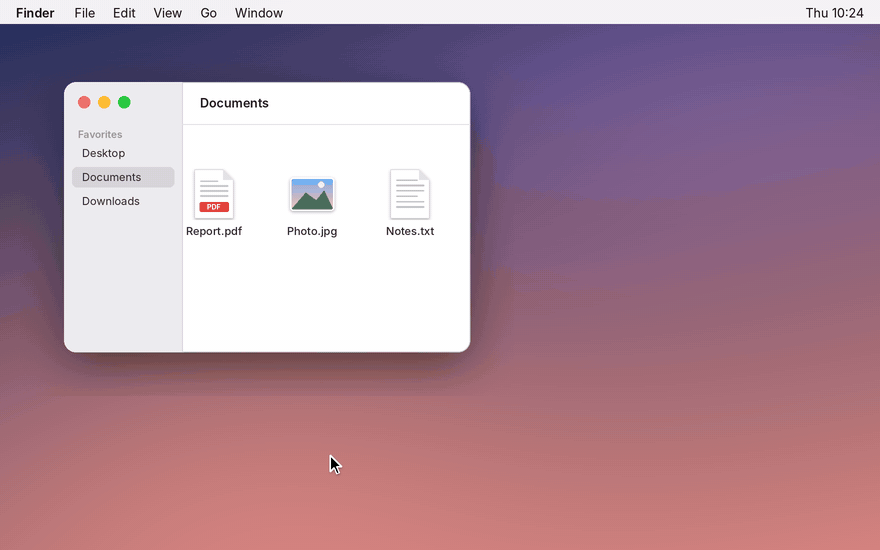

<p align="center">
  
</p>

<h1 align="center">BarDrop</h1>

<p align="center">
  Eine unsichtbare Ablage am Rand deines Bildschirms.<br>
  Zieh eine Datei hinein, hol sie später wieder heraus.
</p>

<p align="center">
  <a href="../README.md">English</a> · <b>Deutsch</b>
</p>

<p align="center">
  <a href="https://github.com/zzuuuiii/BarDrop/releases/latest/download/BarDrop.dmg"><b>Herunterladen</b></a>
  &nbsp;·&nbsp;
  <a href="https://github.com/zzuuuiii/BarDrop/releases">Alle Versionen</a>
  &nbsp;·&nbsp;
  <a href="../CHANGELOG.md">Änderungen (englisch)</a>
</p>

<p align="center">
  <a href="https://github.com/zzuuuiii/BarDrop/releases/latest"></a>
  
  
  <a href="../LICENSE"></a>
</p>

<p align="center">
  
</p>

---

## So funktioniert es

1. **Datei ziehen.** Am Bildschirmrand wölbt sich ein flacher schwarzer Streifen heraus.
2. **Darüber halten.** Die Ablage öffnet sich mit einem leichten Impuls auf dem Trackpad. Loslassen, fertig.
3. **Später.** Zeiger an den Rand, die Ablage geht auf, Datei herausziehen und in jede App ablegen.

Bilder aus dem Browser, Links und Text funktionieren genauso wie Dateien. Beim ersten Start zeigt eine kurze Einführung jeden Schritt zum Mitmachen.

## Installation

1. [**BarDrop.dmg herunterladen**](https://github.com/zzuuuiii/BarDrop/releases/latest/download/BarDrop.dmg) und öffnen.
2. BarDrop im Fenster auf den Ordner **Programme** ziehen.
3. BarDrop aus „Programme“ starten.

> [!NOTE]
> **Warnung beim ersten Öffnen?** macOS meldet bei jeder App, die nicht über Apples kostenpflichtiges Entwicklerprogramm notarisiert ist, dass sie nicht geprüft werden kann. Das bedeutet nicht, dass etwas Schädliches gefunden wurde. Die DMG wird von [GitHub Actions](https://github.com/zzuuuiii/BarDrop/actions) direkt aus diesem Quellcode gebaut.
>
> Einmalig freigeben: Meldung schließen, dann **Systemeinstellungen → Datenschutz & Sicherheit → Trotzdem öffnen**.

Neue Versionen installiert BarDrop danach selbst, wenn du zustimmst (abschaltbar unter Einstellungen → Über BarDrop).

## Funktionen

**Ablage**
* Links oder rechts, feste Höhe oder dort, wo der Zeiger den Rand erreicht (ganzer Rand, mittlere Hälfte oder mittleres Drittel)
* Öffnet sofort oder nach 1 bis 5 Sekunden am Rand, per Klick oder per Kurzbefehl; ein Klick auf den Streifen überspringt die Wartezeit
* Auf Wunsch größerer Trefferbereich, falls du den Streifen knapp verfehlst
* Apps ausnehmen, in denen der Rand die Ablage nicht öffnen soll, zum Beispiel Spiele
* Auch schnell an den Rand geworfene Dateien werden sicher aufgenommen
* Feiner heller Rahmen, damit sie auch auf dunklem Hintergrund zu sehen ist
* Auf allen Bildschirmen oder nur auf dem integrierten bzw. den externen
* Verbraucht im Ruhezustand praktisch keine Energie

**Objekte**
* Dateien, Ordner, Bilder aus dem Web (WebP, AVIF und HEIC werden als PNG oder JPEG gespeichert), Links und Text
* Neue Bildschirmfotos landen auf Wunsch automatisch in der Ablage
* Neueste oder älteste zuerst, Stapel per Auswahl, Auswahl wie im Finder
* Versehentlich entfernt? `⌘Z` holt es zurück
* Verschobene oder umbenannte Dateien bleiben in der Ablage, Dateien aus iCloud werden bei Bedarf geladen, Dateien von getrennten Laufwerken bleiben ausgegraut erhalten
* Inhalt bleibt nach einem Neustart erhalten, auf Wunsch nach 1 bis 24 Stunden automatisch aufgeräumt

**Aktionsleiste**
* AirDrop, Mail, Nachrichten, Teilen, Papierkorb, beliebige Ordner und Apps
* Objekte darauf ziehen oder auswählen und anklicken
* Eine Reihe mit bis zu sechs oder zwei Reihen mit bis zu zehn Aktionen
* Auf Wunsch Ordner und Apps per Ziehen auf die Ablage anheften und Aktionen durch Herausziehen entfernen

**Einstellungen**
* Englisch oder Deutsch
* Kein Symbol in der Menüleiste: Rechtsklick in die Ablage für Einstellungen und Beenden

## Tastatur

| Taste | Aktion |
|---|---|
| `⌃⌥B` | Ablage überall ein- oder ausblenden (unter Einstellungen → Tastatur änderbar) |
| Leertaste, `⌘Y` | Übersicht (Quick Look) |
| `↩`, `⌘O` | Öffnen |
| `⌘R` | Im Finder zeigen |
| `⌘A` | Alle auswählen |
| `⌘X` | Ausschneiden: in die Zwischenablage und aus der Ablage |
| `⌘C`, `⌥⌘C` | Kopieren, Pfad kopieren |
| `⌘V` | Aus der Zwischenablage einfügen |
| `⌫` | Auswahl entfernen, danach ist das nächste Objekt ausgewählt |
| `⌘Z`, `⇧⌘Z` | Widerrufen, wiederholen |
| `⌘,` | Einstellungen |
| Pfeiltasten | Auswahl bewegen, mit `⇧` erweitern |
| `esc` | Auswahl aufheben, Stapel verlassen, dann schließen |

## Datenschutz

BarDrop sammelt keine Daten und sendet nichts über dich. Die Ablage liegt nur auf deinem Mac unter `~/Library/Application Support/BarDrop`. Die einzige Verbindung ins Internet ist die Suche nach Updates bei GitHub; sie lässt sich abschalten. Bilder und Links aus dem Web werden nur dann geladen, wenn du sie selbst in die Ablage ziehst.

## Selbst bauen

```bash
git clone https://github.com/zzuuuiii/BarDrop.git
cd BarDrop
./scripts/build_app.sh        # erzeugt build/BarDrop.app und build/BarDrop.dmg
swift test                    # automatische Tests
```

Benötigt macOS 14 und Xcode 15 oder neuer. Jeder Push auf `main` baut die App, führt die Tests aus und veröffentlicht die DMG als Release der Version in [`VERSION`](../Resources/VERSION).

<details>
<summary><b>Projektaufbau</b></summary>

| Datei | Aufgabe |
|---|---|
| `EdgeController.swift`, `EdgeLogic.swift` | Erkennen von Zeiger und Ziehen, Entscheidung über die Stufen |
| `ShelfPanel.swift`, `ShelfViews.swift`, `EdgeBlobShape.swift` | Fenster, Oberfläche und Form der Ablage |
| `ShelfStore.swift` | Inhalt, Speicherung, Widerrufen |
| `ContentImporter.swift`, `ImageNormalizer.swift`, `CloudFiles.swift`, `FileSanitizer.swift` | Dateien, Web-Bilder, Links und Text übernehmen |
| `DragExport.swift`, `DragSource.swift` | Herausziehen |
| `ShelfActions.swift`, `ActionBar.swift`, `QuickActions.swift` | Auswahl, Menüs, Aktionsleiste |
| `SettingsWindow.swift`, `SettingsView.swift`, `SettingsStyle.swift`, `AppSettings.swift` | Einstellungen |
| `L10n.swift` | Englische und deutsche Texte |
| `Onboarding.swift` | Einführung beim ersten Start |
| `Updater.swift`, `ReleaseNotes.swift` | Updates und Änderungen von GitHub |
| `Tests/` | Automatische Tests |
| `scripts/` | Bauen, DMG, App-Symbol, Vorschau |

</details>

## Danksagung

BarDrop wäre ohne diese Projekte nicht so, wie es ist:

* [**Alcove**](https://tryalcove.com): Vorbild für Form und Bewegung der schwarzen Ablage, die aus dem Bildschirmrand wächst.
* [**Klack**](https://tryklack.com): Vorbild für Aufbau und Gestaltung der Einstellungen.
* [**boring.notch**](https://github.com/TheBoredTeam/boring.notch): Teile des Codes, vor allem die Übernahme von Bildern aus dem Web.
* [**perch**](https://github.com/hausfold/perch): Teile des Codes, mit denen die App verbessert wurde, etwa beim Herausziehen und bei iCloud-Dateien.

Details zu Lizenzen fremden Codes stehen in [THIRD_PARTY_NOTICES.md](THIRD_PARTY_NOTICES.md). BarDrop ist ein eigenständiges Projekt und steht in keiner Verbindung zu diesen Projekten.

## Mitmachen

Fehler und Ideen gern über [Issues](https://github.com/zzuuuiii/BarDrop/issues/new/choose), Sicherheitslücken bitte vertraulich (siehe [SECURITY.md](../.github/SECURITY.md)). Wie Beiträge ablaufen, steht in [CONTRIBUTING.md](../.github/CONTRIBUTING.md).

## Lizenz

© 2026 zzuuuiii. BarDrop ist freie Software unter der [GNU General Public License v3.0](../LICENSE). Du darfst es nutzen, verändern und weitergeben, solange Weitergaben ebenfalls unter der GPL-3.0 stehen und den Quellcode mitliefern. BarDrop wird ohne Gewährleistung bereitgestellt.
